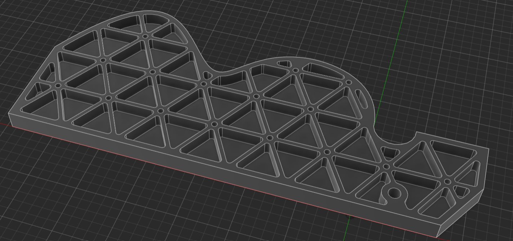
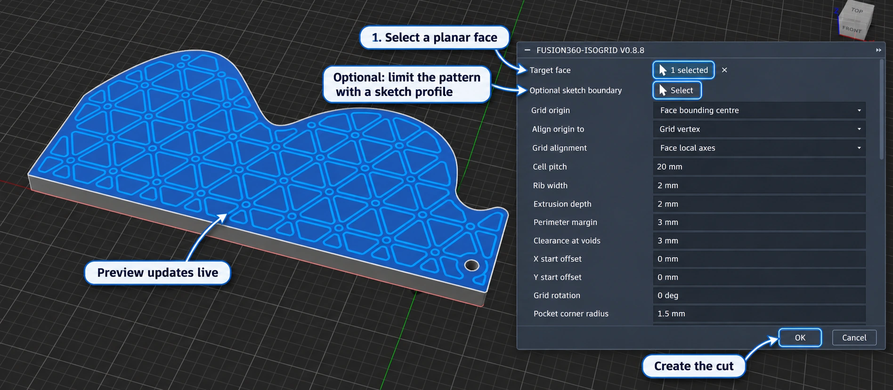
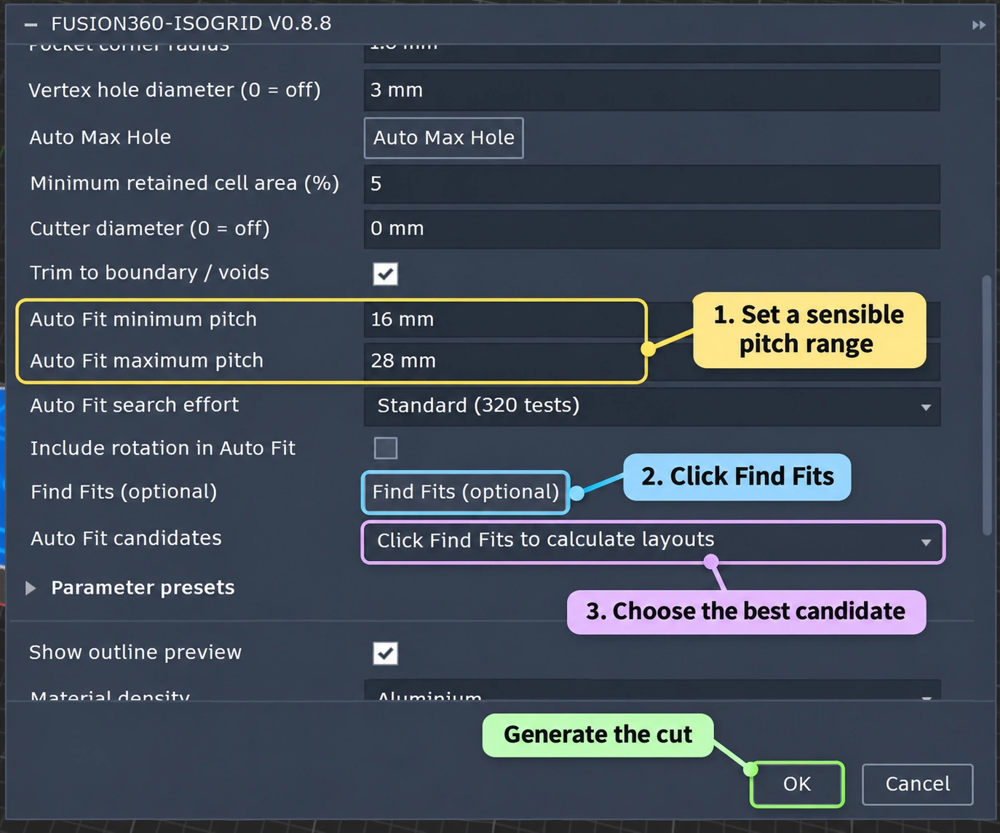
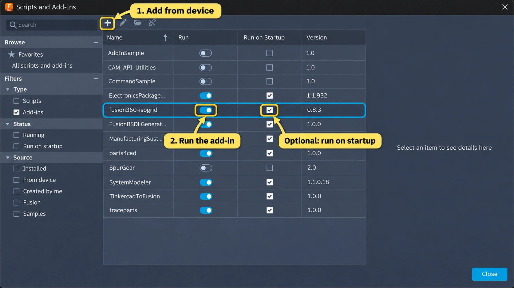
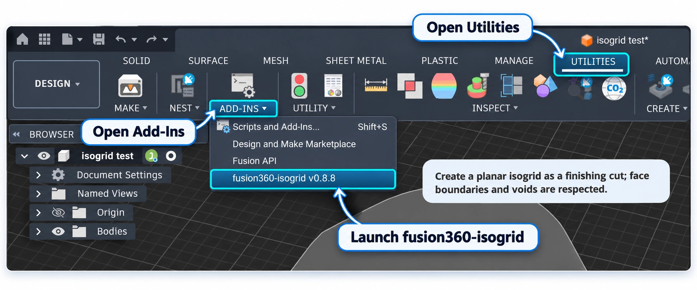
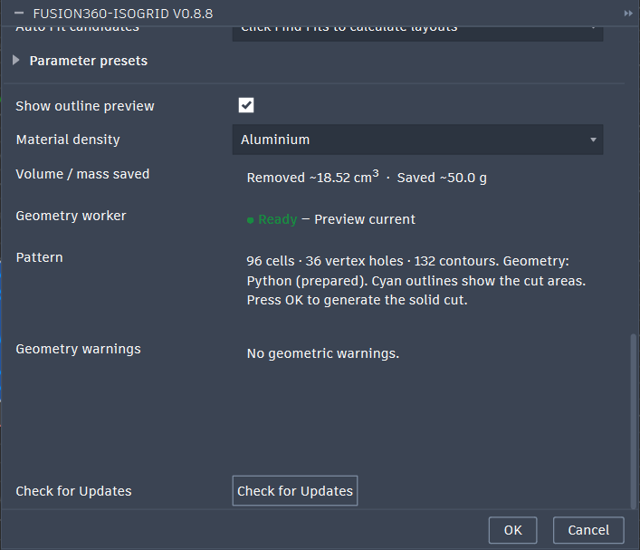

# fusion360-isogrid

Generate isogrid pockets on a planar face in **Autodesk Fusion**. The result is a normal, editable Fusion sketch and extrusion cut.

## Quick start

**Select a planar face → set the Auto Fit pitch limits → Find Fits → choose a candidate → inspect the preview → OK.** Optionally select a sketch profile to limit the patterned area.

## Install

1. Open the [latest GitHub Release](https://github.com/zyeborm/fusion360-isogrid/releases/latest) and download `fusion360-isogrid-vX.Y.Z-github.zip` from its Assets.
2. Extract the ZIP somewhere permanent. The `fusion360-isogrid` folder inside contains `fusion360-isogrid.py` and `fusion360-isogrid.manifest`.
3. In Fusion, open **Utilities → Add-Ins → Scripts and Add-Ins**. Click **+**, add that folder, and switch **Run** on. **Run on Startup** is optional.
4. Launch the command from **Utilities → Add-Ins → fusion360-isogrid**.

The GitHub edition checks stable published Releases for updates when its command opens and downloads an update only after you click **Install Update**. The Autodesk Marketplace edition uses Autodesk-managed distribution and has no built-in updater.

To install a development snapshot instead, you can still use **Code → Download ZIP**; extract and rename its root folder to `fusion360-isogrid`.

[Autodesk's general add-in installation guide](https://help.autodesk.com/cloudhelp/ENU/Fusion-360-API/files/UsingSamplesFromGitHub_UM.htm)

## Controls

| Setting | Purpose |
| --- | --- |
| **Target face** | The planar solid face to pattern. |
| **Optional sketch boundary** | Restrict the pattern to a closed sketch profile on that face. |
| **Cell pitch** | Triangle grid spacing; Auto Fit can choose this for you. |
| **Rib width** | Width of material retained between neighbouring pockets. |
| **Extrusion depth** | Depth of the resulting cut into the solid. |
| **Perimeter margin / Clearance at voids** | Keep material around the outer edge and existing holes. |
| **Pocket corner radius** | Radius of rounded pocket corners. |
| **Auto Fit min/max pitch** | Allowed triangle sizes for the layout search; a narrower sensible range usually gives more relevant choices. |
| **Find Fits / Auto Fit candidates** | Search for placements, then pick a suggested layout. **Maximum removal** is a separate alternative. |

More settings and readouts

| Setting | Purpose |
| --- | --- |
| **Grid origin / Align origin to** | Centre the pattern on the face or use a selected point; align that origin to a grid vertex or triangle centre. |
| **Grid alignment / Grid rotation** | Orient the grid to the face axes, a selected straight edge or a manual angle. |
| **X/Y start offset** | Shift the lattice without changing cell size. |
| **Vertex hole diameter** | Optional circular cuts at lattice intersections; set to 0 to disable. |
| **Auto Max Hole** | Set the nominal maximum junction-hole diameter that preserves a rib-width material web. |
| **Minimum retained cell area (%)** | Omit very small clipped pocket fragments. |
| **Trim to boundary / voids** | Respect the part outline and existing holes (normally on). |
| **Cutter diameter** | Optional machining-access warnings; 0 disables them. This check does not change the pattern. |
| **Auto Fit search effort** | Trade search time for the number of candidate layouts examined. |
| **Include rotation in Auto Fit** | Also vary grid angle during the search. |
| **Parameter presets** | Save and reuse selected settings without changing the chosen face. |
| **Show outline preview** | Toggle the viewport outlines. |
| **Material density** | Choose a material or enter a custom density to estimate mass saved. |
| **Volume / mass saved** | Estimated removed material using the current pockets and cut depth. |
| **Geometry worker / Pattern / Geometry warnings** | Preview readiness, generated-shape counts and diagnostic messages. |
| **Check for Updates** | Manually check GitHub for a newer version. |

The tool supports planar faces bounded by lines, arcs, circles, ellipses and splines, including existing holes. Dimensions and offsets are editable; pocket generation uses native Fusion curves.

[Advanced technical notes](ADVANCED.md) · [Changelog](CHANGELOG.md) · [Licence](LICENSE) · [Privacy](PRIVACY.md) · [Releases](https://github.com/zyeborm/fusion360-isogrid/releases)
